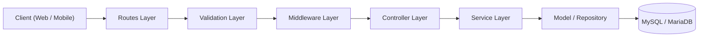
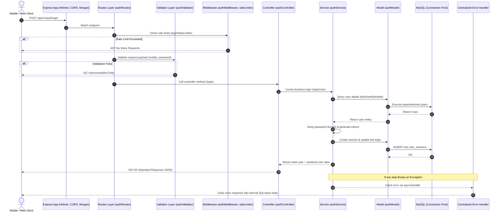
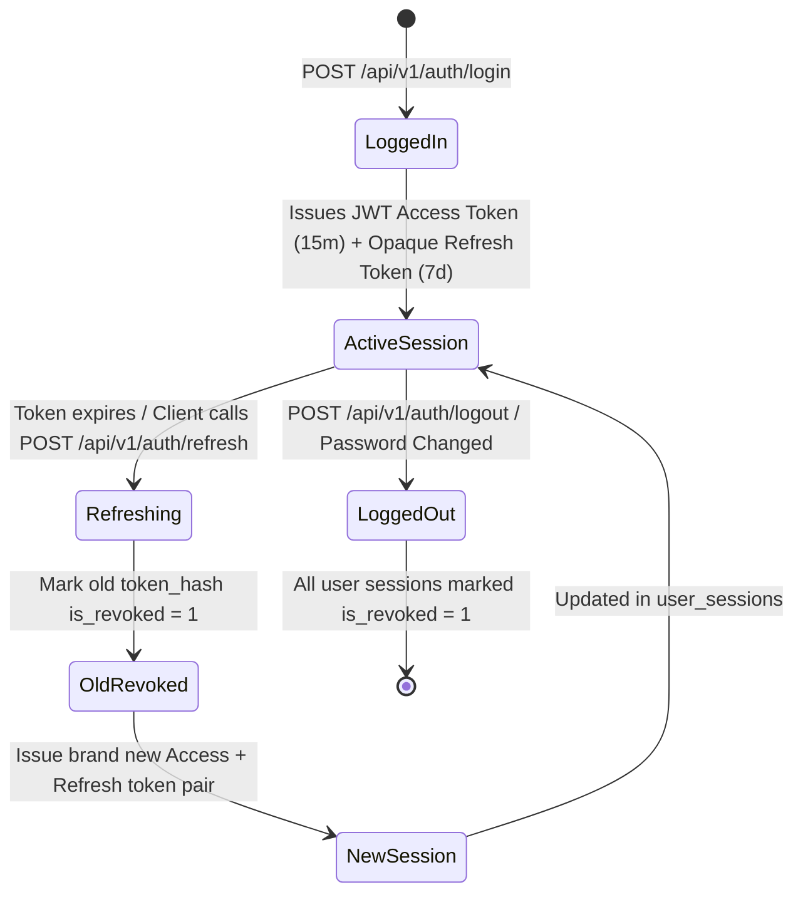
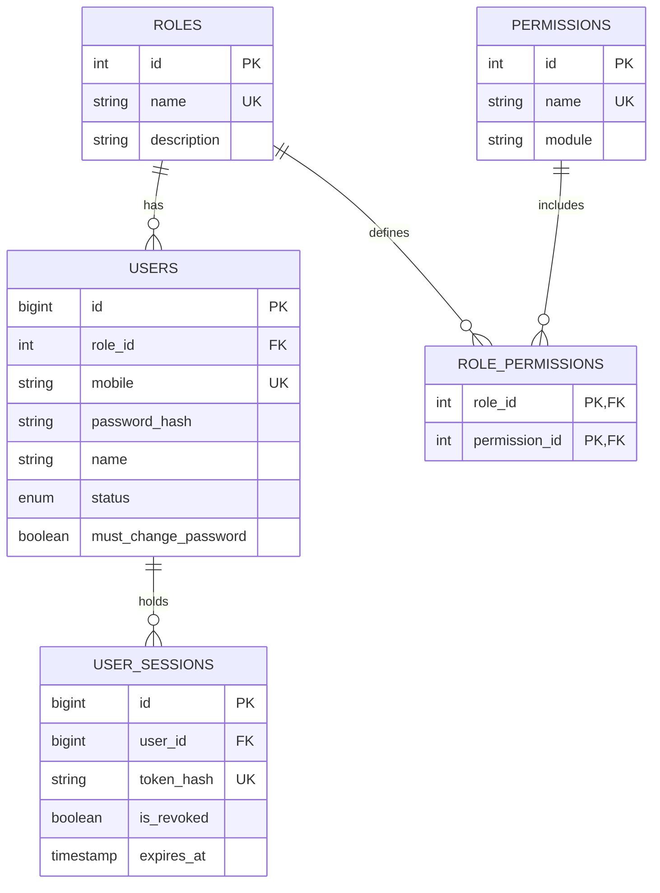

# Mandhiragiri Jothidam – Backend Architecture & Engineering Guide

> A comprehensive architectural breakdown of the **Mandhiragiri Jothidam** backend, detailing the design philosophy, folder organization, request lifecycle, security mechanisms, and engineering benefits.

---

## Table of Contents

1. [Architectural Philosophy & Design Principles](#1-architectural-philosophy--design-principles)
2. [The Request-Response Lifecycle](#2-the-request-response-lifecycle)
3. [Folder Structure & Component Breakdown](#3-folder-structure--component-breakdown)
4. [Why This Architecture? Enterprise Benefits](#4-why-this-architecture-enterprise-benefits)
5. [Core Subsystems Deep Dive](#5-core-subsystems-deep-dive)
   - [Authentication & Token Rotation](#authentication--token-rotation)
   - [Role-Based Access Control (RBAC)](#role-based-access-control-rbac)
   - [Database Connection Pooling & Migrations](#database-connection-pooling--migrations)
   - [Centralized Error & Response Handling](#centralized-error--response-handling)
6. [Team Collaboration Guidelines (3–5 Developers)](#6-team-collaboration-guidelines-35-developers)

---

## 1. Architectural Philosophy & Design Principles

The backend is engineered using the **Layered Architecture (N-Tier)** with the **MVC + Service Layer + Repository/Model Pattern**.



### Core Tenets:
1. **Separation of Concerns (SoC)**: Each file has exactly one responsibility.
2. **Strict Boundary Enforcement**:
   - **Controllers** know about HTTP (requests, headers, status codes) but know **nothing** about business rules or database queries.
   - **Services** know about business rules and domain logic, but know **nothing** about Express `req` or `res` objects, and **never** write direct SQL.
   - **Models** know about SQL and the database schema, but know **nothing** about business validations or HTTP semantics.
3. **Defense in Depth**: Security validations take place at the network perimeter (Helmet/CORS), the route gateway (Rate Limiter), the schema boundary (express-validator), the authorization boundary (JWT/RBAC), and the data boundary (Parameterized SQL).

---

## 2. The Request-Response Lifecycle

Every HTTP request traverses an orchestrated sequence of layers before reaching the database and returning to the client:



---

## 3. Folder Structure & Component Breakdown

```text
mandhiragiri-backend/
├── database/
│   ├── migrations/
│   │   └── 001_create_auth_tables.sql       # DDL Schema definitions
│   ├── seeders/
│   │   └── superAdminSeeder.js              # Idempotent DB seeder
│   └── migrate.js                           # Programmatic migration runner
│
├── src/
│   ├── config/
│   │   └── database.js                      # MySQL2 connection pool & lifecycle
│   │
│   ├── controllers/
│   │   └── authController.js                # HTTP endpoint handlers
│   │
│   ├── middleware/
│   │   ├── authMiddleware.js                # JWT verification, RBAC guards, rate limiter
│   │   └── errorMiddleware.js               # Global error catcher & 404 handler
│   │
│   ├── models/
│   │   └── authModel.js                     # Parameterized SQL query repository
│   │
│   ├── routes/
│   │   └── authRoutes.js                    # Route definitions and middleware binding
│   │
│   ├── services/
│   │   └── authService.js                   # Domain business logic & crypto operations
│   │
│   ├── utils/
│   │   ├── ApiError.js                      # Custom operational exception class
│   │   ├── asyncHandler.js                  # Async wrapper to avoid try/catch boilerplate
│   │   ├── response.js                      # Unified success/error response builders
│   │   └── token.js                         # JWT, random hex tokens, SHA-256 hashing
│   │
│   ├── validators/
│   │   └── authValidator.js                 # Schema validation & field normalization
│   │
│   └── app.js                               # Express application setup & middleware stack
│
├── server.js                                # Entrypoint: port listener & graceful shutdown
├── package.json                             # Dependencies & dev scripts
├── .env                                     # Environment-specific configuration (gitignored)
├── .env.example                             # Environment blueprint for developers
├── .gitignore                               # Git exclusions (credentials, node_modules)
└── README.md                                # Local quickstart & setup manual
```

---

### Detailed Purpose of Each Folder

#### 1. `database/`
* **Why it exists**: Isolates all database schema creation, version control, and data seeding from the runtime application code.
* **`migrations/`**: Contains numbered, idempotent SQL files (e.g. `001_create_auth_tables.sql`). They can be reviewed in pull requests to track schema modifications over time.
* **`seeders/`**: Populates mandatory baseline data (such as default roles, initial permissions, and the system Super Admin). It runs transactionally and idempotently—meaning running it multiple times will not duplicate records or overwrite changed passwords.
* **`migrate.js`**: An automated, vendor-independent migration script that creates the target database if missing, maintains a `schema_migrations` table, and applies unapplied migration files in chronological order.

#### 2. `src/config/`
* **Why it exists**: Houses infrastructure connections and external client configurations.
* **`database.js`**: Initializes a `mysql2/promise` connection pool. Pooling eliminates the overhead of creating and destroying TCP connections for every single HTTP request. It also exposes connection health-checks (`testConnection`) and clean pool teardowns (`closePool`) for graceful shutdown.

#### 3. `src/routes/`
* **Why it exists**: The traffic director of the API.
* **`authRoutes.js`**: Declares HTTP verbs (`GET`, `POST`, `PUT`, `DELETE`) and URLs (`/api/v1/auth/login`, `/me`, etc.). It chains the validator, rate limiter, and authentication middleware before handing control to the controller.

#### 4. `src/validators/`
* **Why it exists**: Guards the entry points against bad or malicious data before any controller or service code executes.
* **`authValidator.js`**: Uses `express-validator` to inspect `req.body`, `req.params`, and `req.query`. It checks for required fields, regex patterns (such as 10–15 digit mobile numbers), and password complexity. It also gracefully normalizes payload field aliases (e.g., mapping `mobileNumber` to `mobile`).

#### 5. `src/middleware/`
* **Why it exists**: Intercepts requests across routes to enforce cross-cutting concerns (authentication, authorization, logging, rate limiting, error handling).
* **`authMiddleware.js`**:
  * Extracts and validates Bearer JWT access tokens.
  * Checks if the user is still active in the database.
  * Attaches user context (`req.user = { id, role, permissions }`).
  * Provides `authorizeRoles('SUPER_ADMIN', 'ADMIN')` and `requirePermission('bookings:manage')` guards.
  * Implements `loginRateLimiter` to safeguard against brute-force attacks.
* **`errorMiddleware.js`**:
  * Global error handler that traps all synchronous and asynchronous errors.
  * Translates database error codes (`ER_DUP_ENTRY`, `ECONNREFUSED`) and JWT errors into friendly client messages without leaking database internals, SQL strings, or credentials.

#### 6. `src/controllers/`
* **Why it exists**: Acts as an HTTP translator.
* **`authController.js`**: Extracts parameters from `req.body`, `req.ip`, and `req.headers`, delegates the actual work to `authService`, and passes the resulting domain data to `sendSuccess(res, message, data, statusCode)`. It contains **no SQL** and **no business calculations**.

#### 7. `src/services/`
* **Why it exists**: The **brain** of the application containing all business rules.
* **`authService.js`**: Orchestrates password comparison using `bcrypt`, generates cryptographically secure access and refresh tokens, implements token rotation, manages session invalidation, enforces account status checks, and handles password reset rules. It is completely independent of the Express framework.

#### 8. `src/models/`
* **Why it exists**: The Data Access Layer (Repository pattern).
* **`authModel.js`**: Contains pure, parameterized SQL queries using `pool.execute(query, [params])`. It ensures total immunity against SQL Injection attacks and isolates schema column changes from the rest of the application.

#### 9. `src/utils/`
* **Why it exists**: Shared, reusable helper functions and classes.
* **`ApiError.js`**: Custom `Error` subclass with HTTP status codes and operational flags.
* **`response.js`**: Standardizes all JSON responses to ensure frontends receive an identical envelope: `{ success, message, data, errors? }`.
* **`token.js`**: Cryptographic functions for JWT signing/verification, random bytes generation, and SHA-256 hashing.
* **`asyncHandler.js`**: Utility that wraps async functions to pass uncaught errors to `next(error)`.

#### 10. `src/app.js` vs `server.js`
* **Why they are separated**:
  * **`src/app.js`**: Configures middleware (Helmet, CORS, Morgan, Body Parsers), mounts routes, and sets up error handlers. It does **not** listen on a network port. This enables unit and integration testing (e.g. using Supertest) without binding to real ports.
  * **`server.js`**: The process runner. It loads environment variables, tests the MySQL database connection, binds to the HTTP port, and registers graceful process termination handlers (`SIGINT`, `SIGTERM`, unhandled rejections).

---

## 4. Why This Architecture? Enterprise Benefits

| Requirement | Traditional Flat / Spaghetti Code | Our Enterprise Architecture |
| :--- | :--- | :--- |
| **Code Modularity** | Single large files mixing routing, SQL, and responses. | Decoupled layers; each file has a single, well-defined responsibility. |
| **Team Scaling (3–5 Devs)** | Multiple developers edit the same file, resulting in Git merge conflicts. | Developers work in separate files (one adds a model, another adds a service, another writes a validator). |
| **Testing** | Difficult to test; requires a live database and active HTTP server. | Services and utilities can be unit-tested in isolation by mocking models. |
| **Security** | Inconsistent input checks, raw queries prone to SQL injection, leaked stack traces. | Parameterized queries everywhere, automated schema validation, and centralized error sanitization. |
| **Maintainability** | Changing a database column name requires edits in 20 different route files. | Only the specific Model file needs updating; Controllers and Services remain untouched. |
| **Client Consistency** | Inconsistent JSON keys and error structures break frontend parsers. | Strict envelope pattern ensures predictable responses for React Native and Web clients. |

---

## 5. Core Subsystems Deep Dive

### Authentication & Token Rotation

Traditional JWT implementations either use long-lived access tokens (security vulnerability) or lack a mechanism to revoke stolen sessions without invalidating all users.

Our architecture implements **Opaque Refresh Token Rotation with Server-Side Revocation**:



1. **Access Token**: Short-lived (15 minutes), stateless JWT containing `{ userId, role }`. Signed with `JWT_ACCESS_SECRET`.
2. **Refresh Token**: Long-lived (7 days), cryptographically secure 40-byte random hex string (`crypto.randomBytes(40)`).
3. **Storage Security**: Plaintext refresh tokens are **never** stored in the database. Only their **SHA-256 cryptographic hash** is stored in the `user_sessions` table. Even if the database is breached, attacker cannot use the hashes to authenticate.
4. **Token Rotation**: Each refresh request consumes the existing refresh token, revokes it, and issues a completely new refresh token.
5. **Breach Detection**: If an already-revoked refresh token is submitted, the system assumes token theft, revokes **all** active sessions for that user, and blocks the request.

---

### Role-Based Access Control (RBAC)

The system supports 4 hierarchical roles:
1. `SUPER_ADMIN`: Full administrative control, system settings, creating `ADMIN` accounts.
2. `ADMIN`: Staff management, creating `PRIEST` and `ASSISTANT` accounts, booking operations.
3. `PRIEST`: Viewing assigned poojas, astrology consultations, Panchangam access.
4. `ASSISTANT`: Assisting priests, schedule logistics, entry verification.



* **Zero Client Role Trust**: Mobile clients cannot send a `role` field to dictate privileges. The role is resolved directly from MySQL at login and embedded into the signed JWT.
* **Guards Available**:
  ```javascript
  // Role check
  router.post('/admin/create', authenticate, authorizeRoles('SUPER_ADMIN'), adminController.create);

  // Granular permission check
  router.get('/bookings', authenticate, requirePermission('bookings:read'), bookingController.list);
  ```

---

### Database Connection Pooling & Migrations

* **Connection Pool**: Configured via `mysql2/promise` with automatic recycling (`connectionLimit: 10`). Connections are automatically acquired and released back to the pool upon query completion.
* **Safe DDL Migrations**: `database/migrations/` stores sequential SQL files. The `database/migrate.js` script:
  1. Creates the database `mandhiragiri_db` if it does not exist with `utf8mb4` encoding.
  2. Creates the tracking table `schema_migrations`.
  3. Applies only unexecuted `.sql` files in sorted alphanumeric order.
  4. Records executed files to guarantee that migrations run exactly once.

---

### Centralized Error & Response Handling

Every single response leaving the server conforms to the standard contract:

#### Success Envelope (`200`, `201`):
```json
{
  "success": true,
  "message": "Login successful",
  "data": {
    "accessToken": "eyJhbGciOi...",
    "refreshToken": "4a7b9f8...",
    "user": { "id": 1, "name": "Super Admin", "role": "SUPER_ADMIN" }
  }
}
```

#### Error Envelope (`400`, `401`, `403`, `404`, `422`, `500`):
```json
{
  "success": false,
  "message": "Invalid mobile number or password",
  "data": null,
  "errors": null
}
```

* **Information Leak Prevention**: The global error handler intercepts all SQL errors (`ER_DUP_ENTRY`, `ECONNREFUSED`) and translates them into safe, readable messages. Raw database queries, server paths, and stack traces are never sent to clients in production.

---

## 6. Team Collaboration Guidelines (3–5 Developers)

### Adding a New Feature (e.g., Bookings Module)

To build a new feature without breaking existing code or creating Git merge conflicts:

1. **Database Layer**: Add a new migration `database/migrations/002_create_bookings_tables.sql` and run `npm run migrate`.
2. **Model Layer**: Create `src/models/bookingModel.js` with parameterized queries.
3. **Service Layer**: Create `src/services/bookingService.js` containing business validation and booking logic.
4. **Validation Layer**: Create `src/validators/bookingValidator.js` defining input schemas.
5. **Controller Layer**: Create `src/controllers/bookingController.js` handling HTTP extraction and response formatting.
6. **Routes Layer**: Create `src/routes/bookingRoutes.js` and mount it under `/api/v1/bookings` in `src/app.js`.

### Git Workflow
* Never commit directly to `main` or `develop`.
* Branch off `develop` using `feature/<module-name>`.
* Submit a Pull Request with at least 1 team code review before merging.
* Keep `.env` strictly local; always document new variables in `.env.example`.
